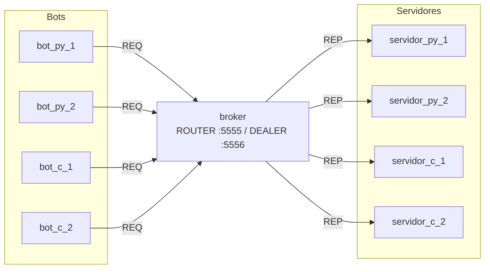

# Projeto Atlas: sistema de troca de mensagens instantâneas

Projeto da disciplina **CC7261 - Sistemas Distribuídos** (FEI). É uma versão simplificada de um BBS/IRC em que bots (clientes) fazem login, criam e listam canais públicos. Os servidores respondem às requisições e guardam os dados em disco.

**Integrantes**

| Nome | RA | Linguagem |
|---|---|---|
| Brayan André da Costa | 22124005-4 | Python |
| Gustavo Souza Alvarenga | 22124058-3 | C |

> **Parte 1:** login de usuário, criação e listagem de canais.

## Como executar

```bash
docker compose up --build
```

O comando sobe todos os containers: 1 broker, 4 servidores (2 em Python e 2 em C) e 4 bots (2 em Python e 2 em C). Nenhuma interação com o usuário é necessária. Para parar, use `Ctrl+C` e depois `docker compose down`.

Os dados de cada servidor ficam na pasta `dados/<nome_do_servidor>/` do host. Para começar do zero, apague a pasta `dados/`.

## Arquitetura



- **broker** (`broker/broker.py`): é o mesmo modelo da aula de Request-Reply. Os bots se conectam com `REQ` na porta 5555 (`ROUTER`) e os servidores com `REP` na porta 5556 (`DEALER`). O `DEALER` distribui as requisições entre os servidores por round-robin, então qualquer bot conversa com qualquer servidor, de qualquer linguagem.
- **servidores** (`python/servidor.py` e `c/servidor.c`): recebem a requisição, validam, gravam em disco e respondem.
- **bots** (`python/cliente.py` e `c/cliente.c`): fazem login e depois ficam em loop listando canais e criando um canal novo quando existem menos de 5.

Toda a comunicação usa ZeroMQ e a rede criada pelo Docker Compose. Os hosts são os nomes dos serviços: `broker`.

## Escolhas do projeto

### Linguagens
- **Python**: biblioteca `pyzmq`, a mesma usada nas aulas.
- **C**: `libzmq` (API C do ZeroMQ) e `protobuf-c`. C foi a outra linguagem usada nas aulas (MPI). O código não usa orientação a objetos.

As duas implementações seguem exatamente o mesmo protocolo e o mesmo formato de exibição. Por isso um bot em C pode ser atendido por um servidor em Python e o contrário também.

### Serialização: Protocol Buffers
As mensagens são serializadas em binário com **Protobuf**, que foi o formato visto na aula de RPC. A definição fica em `proto/mensagens.proto` e é compilada durante o build da imagem:
- Python: `python -m grpc_tools.protoc --python_out=. mensagens.proto` (mesmo comando da aula de RPC);
- C: `protoc-c --c_out=. mensagens.proto`.

```proto
message Requisicao {
  string operacao  = 1;  // "login" | "criar_canal" | "listar_canais"
  string usuario   = 2;
  string canal     = 3;
  int64  timestamp = 4;  // timestamp do envio (ms desde a época Unix)
}

message Resposta {
  string operacao        = 1;
  bool   sucesso         = 2;
  string erro            = 3;
  repeated string canais = 4;  // lista de canais (somente nomes)
  string servidor        = 5;
  int64  timestamp       = 6;  // timestamp do envio
}
```

Todas as mensagens levam o **timestamp do envio**, em milissegundos desde 1970-01-01 UTC. O campo `servidor` mostra qual servidor atendeu, o que ajuda a ver o balanceamento entre Python e C.

### Trocas de mensagem

| Operação | Requisição (REQ) | Resposta (REP) |
|---|---|---|
| Login | `operacao=login`, `usuario` | `sucesso` ou `erro` |
| Criar canal | `operacao=criar_canal`, `usuario`, `canal` | `sucesso` ou `erro` |
| Listar canais | `operacao=listar_canais`, `usuario` | `canais` = lista com os nomes |

Cada requisição recebe exatamente uma resposta, como manda o padrão REQ/REP.

### Erros e regras definidas pelo grupo
- **Nome de usuário**: de 1 a 32 caracteres `[A-Za-z0-9_-]`. Sem senha. Um mesmo usuário pode fazer login de novo, por exemplo quando o bot reinicia, e cada login é registrado. Erro: `nome de usuario invalido`.
- **Nome de canal**: de 1 a 32 caracteres `[a-z0-9_-]`. Erros: `nome de canal invalido` e `canal ja existe`, para canais duplicados.
- **Operação desconhecida ou mensagem mal formada**: o servidor responde mesmo assim, com `sucesso=false` (o socket `REP` sempre precisa responder).
- **Falha de gravação em disco**: o servidor responde com erro.
- **Login com erro**: o bot espera 1 s e repete o login até conseguir.
- **Critério para criar canal**: quando a listagem tem menos de 5 canais, o bot sorteia um nome de uma lista fixa (`geral`, `noticias`, `esportes`...) e pede a criação. Se o canal já existir, o bot apenas mostra o erro e continua.

### Persistência
Cada servidor tem a sua própria pasta de dados, montada como volume em `/data`. Essa pasta não é compartilhada entre servidores. Os arquivos são texto separado por TAB (TSV), com uma linha por evento e gravação por *append*:

| Arquivo | Colunas |
|---|---|
| `logins.tsv` | timestamp (ms), data legível, usuário |
| `canais.tsv` | timestamp (ms), data legível, canal, usuário que criou |

Escolhemos TSV porque é simples de gravar e ler nas duas linguagens, sem bibliotecas extras, e porque dá para abrir e conferir o arquivo direto. Ao iniciar, o servidor relê `canais.tsv` e recupera os canais criados antes.

Como o broker usa round-robin e ainda não existe replicação (ela vem na parte 5), cada servidor conhece apenas os canais criados por meio dele. Por isso a listagem pode variar conforme o servidor que responde.

### Exibição das mensagens
Clientes e servidores mostram cada mensagem enviada ou recebida em uma linha com todos os campos:

```
[2026-10-22 20:02:23.880] bot_c_1        >>> ENVIADO  REQ {operacao: criar_canal, usuario: bot_c_1, canal: off-topic, timestamp: 2026-10-22 20:02:23.880}
[2026-10-22 20:02:23.888] bot_c_1        <<< RECEBIDO REP {operacao: criar_canal, sucesso: true, servidor: servidor_c_2, timestamp: 2026-10-22 20:02:23.884}
```

## Estrutura do repositório

```
├── docker-compose.yaml
├── proto/mensagens.proto     
├── broker/broker.py          
├── python/                 
│   ├── Dockerfile            
│   ├── comum.py
│   ├── servidor.py
│   └── cliente.py
└── c/                      
    ├── Dockerfile
    ├── Makefile
    ├── comum.h / comum.c
    ├── servidor.c
    └── cliente.c
```
